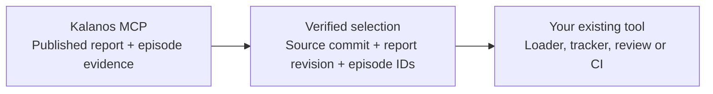

# Kalanos MCP

### Published dataset evidence, connected to the tools you already use.

Kalanos MCP integrations turn a published assessment into a reproducible input
for an existing robotics workflow. Start with a report, inspect the recorded
decisions, verify the source revision, and carry the selected episodes into the
next tool.

**Status: source preview.** Integrations here are not yet published on PyPI. The
hosted Kalanos MCP service already exists; its server implementation is not part
of this repository.

[Browse integrations](integrations/) ·
[Understand the design](docs/ARCHITECTURE.md) ·
[Read the trust boundaries](docs/TRUST_BOUNDARIES.md) ·
[Contribute](CONTRIBUTING.md)

---

## Where MCP fits



- **MCP is the evidence interface.** The client reads existing published reports.
  It does not start grading or mutate the Hub.
- **The selection is the contract.** It records the policy, exact source revision,
  report identity and verified source episode indices.
- **The integration is a thin handoff.** It passes those inputs to the existing
  tool. That tool remains responsible for loading, training or review.

A high readiness score does not substitute for episode decisions. Missing,
unknown or unassessed evidence never becomes a pass.

## Integrations

Each directory under [`integrations/`](integrations/) is an independent,
installable integration for one tool, with its own README, dependencies,
lockfile, examples, tests and real-data verification. That README states the
integration's status, supported versions and limits. The contract a new
integration follows is in [integrations/README.md](integrations/README.md).

## Quick start

Use Python **3.12**, Git and [`uv`](https://docs.astral.sh/uv/). Choose an
integration and follow its README. In general:

```bash
cd integrations/<tool>
uv sync --frozen        # add the optional extras its README names, if any
```

## Evidence standard

Every integration documents a real-data check: the exact source revision, report
revision, software versions, checks run and limitations. Results state what was
and was not measured. No integration claims a training or performance
improvement unless it measured one.

## Current boundaries

- The initial selection policy includes only explicit `pass` decisions. `review`,
  `blocked` and `unknown` are held out separately. Human overrides are not implemented.
- A saved report revision is not a report-history service. Refresh evidence when
  currentness matters.
- Integrations do not launch training, tracker uploads, dataset publication or
  deployments.
- Tool-specific boundaries are in each integration's README.

## Repository layout

```text
kalanos-mcp/
├── README.md
├── SECURITY.md
├── docs/
│   ├── ARCHITECTURE.md
│   └── TRUST_BOUNDARIES.md
└── integrations/
    ├── README.md
    └── <tool>/
        ├── README.md
        ├── pyproject.toml
        ├── uv.lock
        ├── src/
        ├── tests/
        ├── docs/
        └── examples/
```

## Development

From an integration's directory:

```bash
uv sync --frozen
uv run --frozen ruff check .
uv run --frozen ruff format --check .
uv run --frozen pytest
```

CI runs this for every integration automatically. Unit tests do not call
external services. See [CONTRIBUTING.md](CONTRIBUTING.md) for validation
expectations.

## License

Integration code: [Apache-2.0](LICENSE). Datasets and upstream tool licenses
remain their own.

## Trademarks and affiliation

All product, company and project names, including those of tools these
integrations connect to, are trademarks of their respective owners. They are used
only to identify compatibility. This project is an independent integration by
Kalanos AI and is not affiliated with, sponsored by or endorsed by those owners.

## Security

Report suspected vulnerabilities privately; see [SECURITY.md](SECURITY.md).
Design-level trust boundaries are in
[docs/TRUST_BOUNDARIES.md](docs/TRUST_BOUNDARIES.md).
