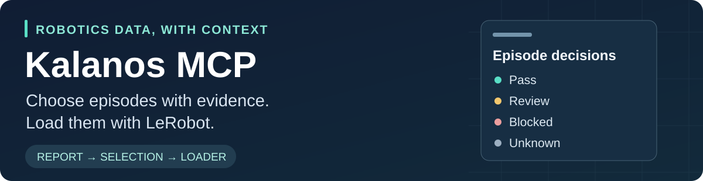
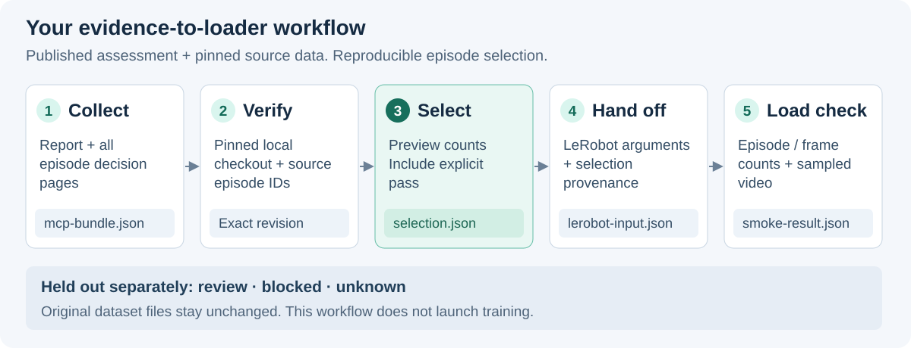

# Kalanos MCP



[](https://github.com/KalanosAI/kalanos-mcp/actions/workflows/tests.yml)
[](LICENSE)
[](#try-it-with-a-public-lerobot-dataset)
[](https://www.python.org/downloads/)
[](integrations/lerobot/docs/REAL_DATA_TEST.md)
[](https://modelcontextprotocol.io/)
[](https://docs.astral.sh/uv/)
[](https://docs.astral.sh/ruff/)
[](https://github.com/KalanosAI/kalanos-mcp/commits/main)
[](SECURITY.md)
[](mailto:reports@kalanos.ai)

### Choose robotics training episodes with evidence. Load them with LeRobot.

For robotics engineers preparing imitation-learning experiments, Kalanos MCP
connects published dataset reports to an explicit, reproducible episode
selection. See which episodes need review, verify that the report matches your
local data, and pass the selected source indices to your existing LeRobot loader.

Start with **LeRobot**, the first available integration. You do not need to run
the Kalanos grader CLI or host an MCP server.

**Status: source preview.** Install from this repository; it is not on PyPI yet. The
hosted Kalanos MCP service already exists, and its server is not part of this repository.

[Explore the Data Hub](https://hub.kalanos.ai/) ·
[Run the LeRobot walkthrough](integrations/lerobot/README.md) ·
[Replay the captured report](integrations/lerobot/README.md#1-collect-the-current-published-report) ·
[See the verified example](integrations/lerobot/docs/REAL_DATA_TEST.md) ·
[Visit Kalanos](https://kalanos.ai/)

## From a dataset report to your training input

You have a dataset and a training pipeline. Before the next run, you need to
know which episodes to include, which to inspect, and how to reproduce that
choice later.

This repository provides tool-specific integrations that read existing Kalanos
reports through MCP, the Model Context Protocol. The current LeRobot adapter:

1. Collects the report and all episode decision pages.
2. Verifies source episode indices against your pinned local dataset checkout.
3. Separates selected episodes from those held out for review or other decisions.
4. Exports a JSON selection manifest and LeRobot loader arguments.
5. Checks that LeRobot actually loads the intended episodes and frame counts.



The adapter prepares the dataset input. You choose the policy model, training
configuration and evaluation protocol.

## What you get

| Your question | What the integration gives you |
| :--- | :--- |
| Which episodes should I inspect before a run? | Separate `pass`, `review`, `blocked` and `unknown` counts, with the underlying report evidence retained. |
| Do these episode IDs refer to my local data? | Source-index checks against committed LeRobot metadata, rather than assuming report keys are loader indices. |
| Can I reproduce this selection? | A manifest with the source commit, report identity, selection policy and selected episode indices. |
| Can I keep my existing training stack? | Arguments for LeRobot's `LeRobotDataset`, without replacing the loader or trainer. |
| Did the handoff actually work? | A smoke check of every loaded episode ID and per-episode frame count, plus sampled video decoding. |

The initial policy includes only explicit `pass` decisions. It holds out
`review`, `blocked` and `unknown` separately. A review flag is a reason to
inspect an episode, not proof that it would harm training.

## Is this for you?

**Good fit:** you use LeRobot with a v3.0 dataset from the Hugging Face Hub that has a
published Kalanos report, you are preparing an imitation-learning experiment, and you
want a reproducible, verified episode selection.

**Not a fit:** a dataset with no published report, v2 datasets, streaming loads, or
stacks other than LeRobot. Those need an assessment first or a different adapter.

## Try it with a public LeRobot dataset

**Requirements:** Python 3.12, Git and [uv](https://docs.astral.sh/uv/).
The complete example was tested on macOS with LeRobot 0.7.0 and dataset format
v3.0. Packages are installed from this repository; this is a **source preview**,
not a PyPI release.

### 1. Install and collect the report

```bash
git clone https://github.com/KalanosAI/kalanos-mcp.git
cd kalanos-mcp/integrations/lerobot
uv sync --frozen --extra lerobot
source .venv/bin/activate

export RUN_DIR="$PWD/artifacts/xarm-demo"
mkdir -p "$RUN_DIR"
kalanos-lerobot fetch lerobot/xarm_lift_medium_replay \
  -o "$RUN_DIR/mcp-bundle.json"
```

This reads published evidence from `https://mcp.kalanos.ai/mcp`. It does not
start a new assessment or download the dataset. Public collection requires no
account. For collection and export without the LeRobot loader, omit
`--extra lerobot`.

### 2. Download the matching source revision

Follow the [pinned-dataset download steps](integrations/lerobot/README.md#2-materialize-that-exact-dataset-revision)
to create `DATASET_ROOT` from the exact source commit recorded in your bundle.
The xArm example is approximately 18.9 MB, including video.

Use a hydrated Hugging Face **Git checkout**, not an arbitrary folder or a
checkout of the latest branch. The adapter verifies the local source before
exporting indices.

### 3. Preview, export and verify loading

Once `DATASET_ROOT` points to that checkout:

```bash
kalanos-lerobot preview "$RUN_DIR/mcp-bundle.json" --dataset "$DATASET_ROOT"

kalanos-lerobot export "$RUN_DIR/mcp-bundle.json" --dataset "$DATASET_ROOT" \
  -o "$RUN_DIR/selection.json"

kalanos-lerobot handoff "$RUN_DIR/selection.json" --dataset "$DATASET_ROOT" \
  -o "$RUN_DIR/lerobot-input.json"

HF_HUB_OFFLINE=1 kalanos-lerobot smoke "$RUN_DIR/selection.json" \
  --dataset "$DATASET_ROOT" -o "$RUN_DIR/smoke-result.json"
```

Use a fresh output directory for another run. Existing files are not silently
overwritten. The [complete walkthrough](integrations/lerobot/README.md#walkthrough)
includes the Python loader example, captured-report replay and troubleshooting.

### What you keep with the experiment

| File | Purpose |
| :--- | :--- |
| `mcp-bundle.json` | Report and complete episode decision inventory from one report revision. |
| `selection.json` | Verified pass-only episode selection and provenance. |
| `lerobot-input.json` | Local loader arguments, selection metadata and manifest hash. |
| `smoke-result.json` | Actual load-check results and sampled observation shapes. |

These are selection and evidence artifacts, **not a newly merged or rewritten
dataset**. Source files stay in your local checkout. Regenerate the handoff on
another machine because its local dataset path is machine-specific.

## A real example: 800 episodes, two held for review

The recorded run used
[`lerobot/xarm_lift_medium_replay`](https://huggingface.co/datasets/lerobot/xarm_lift_medium_replay),
with the task instruction “Pick up the cube and lift it.”

| Recorded result | Value |
| :--- | :--- |
| Episodes assessed | 800 |
| Selected under the pass-only policy | 798 |
| Held for review | Source indices 38 and 46 |
| Review evidence | Brightness deviation relative to the same-camera baseline |
| Frames loaded by LeRobot | 19,950 |
| Sampled video check | Six frames decoded successfully |

The [verification record](integrations/lerobot/docs/REAL_DATA_TEST.md) includes
the exact source and report revisions, checks and retained evidence. These are
recorded results, not promised counts for a future live report. No training or
model-performance improvement was measured.

The captured evidence files can be browsed without installing anything in
[`integrations/lerobot/examples/xarm-lift-demo`](integrations/lerobot/examples/xarm-lift-demo/).
Replaying the report still needs the pinned source download described above.

## Available now, with room for more tools

| Integration | Status | Output |
| :--- | :--- | :--- |
| [LeRobot](integrations/lerobot/) | Source preview; recorded end-to-end load test | Verified episode manifest and loader arguments |

Each integration has its own dependencies, examples and tests. Additional
adapters can live alongside LeRobot without becoming dependencies of it. See the
[integration contract](integrations/README.md) to contribute one.

This repository contains **clients of the hosted MCP service**, not its server
implementation. It is separate from the [Kalanos grader CLI](https://github.com/KalanosAI/kalanos).

## Know the scope before using a selection

- **Existing reports only:** MCP reads published assessments. It does not grade
  an unassessed local dataset or upload your dataset files.
- **Scope matters:** a pass applies to the recorded checks. Missing or unchecked
  evidence is not a pass, and a selection does not establish task success.
- **Current adapter:** LeRobot 0.7.0, v3.0 metadata and non-streaming loading.
  Multi-dataset mixing, format conversion and human decision overrides are not
  implemented by this adapter.
- **No automatic training or publishing:** commands do not launch training,
  tracker uploads, dataset publication or deployments.
- **Saved evidence, not report history:** the service does not offer historical
  report retrieval. Keep your bundle and refresh it when currentness matters.
- **Local checks have limits:** the adapter verifies consumed index metadata;
  it does not continuously rehash every video or data file. A manifest hash
  identifies its bytes, not the publisher's authenticity.

See the [LeRobot guide](integrations/lerobot/README.md#current-boundaries) and
[trust boundaries](docs/TRUST_BOUNDARIES.md) for details.

## Contribute and validate

From an integration directory:

```bash
uv sync --frozen
uv run --frozen ruff check .
uv run --frozen ruff format --check .
uv run --frozen pytest
```

Unit tests do not call external services. See [CONTRIBUTING.md](CONTRIBUTING.md)
for validation expectations and [architecture](docs/ARCHITECTURE.md) for the
shared design. Report suspected vulnerabilities privately using
[SECURITY.md](SECURITY.md). For other questions or reports, email
[reports@kalanos.ai](mailto:reports@kalanos.ai).

## License and attribution

Integration code is licensed under [Apache-2.0](LICENSE). Datasets and upstream
tools retain their own licenses. LeRobot and Hugging Face are trademarks of their
respective owners. Other product and project names identify compatibility only. This
independent Kalanos AI integration is not affiliated with, sponsored by or endorsed by
their owners.
